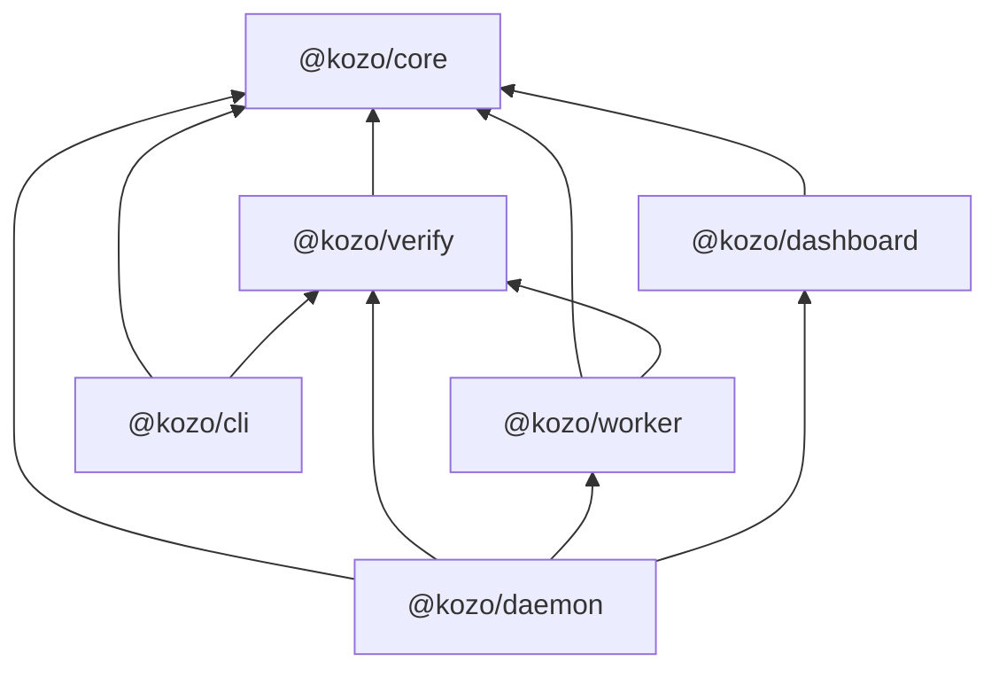
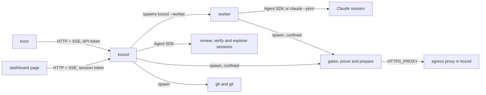

# Architecture

How kozo is built: its packages, the processes they run as, what crosses each trust boundary,
and the code and tests that keep the design invariants. What a user sees of the same parts is
on the site's [Architecture](../site/src/content/docs/architecture.md) and
[Concept](../site/src/content/docs/concept.md) pages.

## Packages

| Package | Holds |
| --- | --- |
| `packages/core` | The versioned zod schemas of every persisted format and of the API, the replay of events into state, the autonomy rules and the message catalogs. It runs nothing |
| `packages/verify` | The gates, the diff guard, prove, review and verify, the command sandbox and the Claude sessions that judge |
| `packages/worker` | The worker process: one agent session in one worktree, behind the guard and the task sandbox |
| `packages/daemon` | kozod: the event store and its index, the scheduler and the blueprint nodes, the local API, GitHub, notifications and evals |
| `packages/cli` | `kozo`, a client of the local API, and the standalone `gates`, `diff-guard`, `prove`, `review` and `verify` commands |
| `packages/dashboard` | The dashboard page, which kozod embeds and serves |
| `testing` | Fixtures, the fake agent and the fake GitHub the tests share |

The arrows are every dependency between the packages. Nothing depends on `@kozo/daemon` or
`@kozo/cli`, and `@kozo/core` depends on no other package.

## Processes

- **kozo → kozod.** `packages/cli/src/client.ts` talks HTTP and SSE to `127.0.0.1` with the API
  token, after kozod proves it holds the token. `kozo up` spawns kozod detached, and `kozo down`
  signals the pid in `kozod.pid`.
- **Dashboard page → kozod.** kozod serves the page, which trades a one-time code for a session
  token (`packages/daemon/src/dashboard-session.ts`) and then talks to the same origin.
- **kozod → worker.** `packages/daemon/src/launcher.ts` spawns `kozod --worker` with a spec file
  the run records. The worker reports in JSON lines on stdout, which
  `packages/daemon/src/session-pump.ts` reads, and takes the owner's instructions from the run's
  `queue.jsonl`. Stopping is SIGTERM, then SIGKILL.
- **Worker → Claude session.** Either the Agent SDK (`packages/worker/src/claude-agent.ts`) or
  `claude --print` (`packages/worker/src/claude-cli-agent.ts`), whose hooks and MCP server reach
  the worker through a unix socket guarded by a token (`packages/worker/src/cli-bridge.ts`).
- **kozod → judging sessions.** Review, verify and the explorer run inside kozod through the
  Agent SDK (`packages/verify/src/judge.ts`).
- **Commands.** Gates, prove and prepare are child processes confined by Seatbelt or bubblewrap
  (`packages/verify/src/sandbox.ts`). Only prepare may reach other hosts, through kozod's egress
  proxy (`packages/daemon/src/egress.ts`) with a token of its own.
- **kozod → GitHub.** `gh` through the wrapper in `packages/daemon/src/github.ts`, and `git`
  pushes whose credentials come from `gh auth git-credential`.

## Trust boundaries

| Boundary | What crosses it | What guards it |
| --- | --- | --- |
| A local client to kozod | Reads and verbs, each one API call | Bound to `127.0.0.1`, the API or session token, the Host and Origin checks (`packages/daemon/src/api.ts`) |
| A request to a model | The request's text, a draft, a check's output | `wrapRequest` in `packages/core/src/brief.ts`, and the agents' instructions that say the tag is data |
| kozod to a worker | The brief, the task's policy and instructions | An environment with no credentials (`sessionEnvironment` in `packages/verify/src/judge.ts`) |
| An agent to the machine | Tool calls and shell commands | The guard (`packages/worker/src/guard.ts`), the task sandbox (`packages/worker/src/task-sandbox.ts`) and Claude Code's sandbox (`localSandbox` in `packages/verify/src/judge.ts`) |
| A command to the machine | Gates, prove and prepare | The command sandbox (`packages/verify/src/sandbox.ts`) and the egress proxy |
| kozod to GitHub | Comments, labels, branches and pull requests | The gh wrapper's list (`ghAllowed` in `packages/daemon/src/github.ts`) |

## Design invariants

AGENTS.md states each of these; `packages/core/src/docs.test.ts` fails when the two lists differ.
A cell that says none names a gap.

| Invariant | Kept by | Checked by |
| --- | --- | --- |
| Only kozod writes state. The CLI and the dashboard are stateless clients of the local API. | `EventStore` in `packages/daemon/src/event-store.ts`, the only writer of the logs and the index; `claimHome` in `packages/daemon/src/daemon.ts`, one kozod per home; `packages/cli/src/client.ts` and `packages/dashboard/src/api.ts` reach state only through the API | `event-store.test.ts`; `daemon.test.ts` (one kozod per home); none that the clients never write |
| Decisions that can be made deterministically are code in kozod. Models only classify, draft plans, implement, review, judge DONE_WHEN by driving the app, and answer the owner's questions from the records. | The blueprint nodes in `packages/daemon/src/nodes.ts`, `layersFor` in `packages/daemon/src/risk.ts`, `checkPlan` in `packages/daemon/src/plan-checks.ts`, the branches in `packages/core/src/state.ts` and `packages/core/src/autonomy.ts`; the agents are `agentNameSchema` in `packages/core/src/work-model.ts` | `plan-checks.test.ts`, `state.test.ts` (branches), `risk.test.ts`, `autonomy.test.ts`, `flow.test.ts`; none pins the agents |
| Humans always merge. Nothing in kozo has a merge command, and the gh wrapper allows only listed subcommands. | `verbSchema` in `packages/core/src/api.ts`, which has no merge; `ghAllowed` and `ghGitHub` in `packages/daemon/src/github.ts`; the guard refuses merges in `packages/worker/src/guard.ts` | `github.test.ts` (only the listed commands), `dashboard.test.ts` (never a merge), `guard.test.ts` |
| Workers hold no GitHub credentials and write only inside their worktree. Only kozod pushes and opens pull requests, and only after verification passes. | `sessionEnvironment` in `packages/verify/src/judge.ts` and `commandEnvironment` in `packages/verify/src/command.ts`; `deniedCredentials` in `packages/verify/src/sandbox.ts`; `checkWrite` in `packages/worker/src/guard.ts` and `taskSandbox` in `packages/worker/src/task-sandbox.ts`; `handOff` in `packages/daemon/src/github-sync.ts`, which waits for the `handoff.ready` that only `finalVerify` in `packages/daemon/src/nodes.ts` appends | `claude-agent.test.ts`, `gates.test.ts`, `task-sandbox.test.ts`, `guard.test.ts`, `sandbox.test.ts`, `github-sync.test.ts`, `flow.test.ts` (awaiting merge after final verification); none that nothing is pushed before `handoff.ready` |
| Event logs are append-only, the SQLite index can always be rebuilt from them, and every persisted format carries a version. | `EventStore` writes in append mode and seals a run's log; `parseEventLog` and `sealIssues` in `packages/core/src/event-log.ts`; `EventStore.open` rebuilds the index at every start (`packages/daemon/src/index-db.ts`); `eventVersion`, `indexSchemaVersion` and each schema's `version` | `event-log.test.ts`, `event-store.test.ts`, `state.test.ts` (a sealed run), `event.test.ts` and each schema's version test |
| Request bodies are untrusted data wrapped in `<request trust="untrusted">`, never instructions. | `wrapRequest` in `packages/core/src/brief.ts`, used by `renderBrief`, `packages/daemon/src/drafting.ts`, `packages/daemon/src/nodes.ts` and `packages/daemon/src/github-sync.ts` | `flow.test.ts` (the triage and plan prompts), `github-sync.test.ts` (the escape), `review.test.ts`; none for the implement brief |
| The local API binds to `127.0.0.1`, requires the API token, checks Origin on writes and enables no CORS. kozo opens no public port. | `serveApi` and the checks before every route in `packages/daemon/src/api.ts`; `apiToken` in `packages/daemon/src/api-token.ts`; every other listener binds to `127.0.0.1` or a unix socket | `api.test.ts` (token, host, origin and no CORS header), `daemon.test.ts` (the page without the token); none for the bind address |

Where the code steps outside an invariant today:

- `kozod --eval` merges task branches in its throwaway clone (`packages/daemon/src/eval.ts`) in
  the owner's place.
- `install` in `packages/daemon/src/github-sync.ts` pushes kozo's own files and opens their pull
  request with no verification, since no task produced them.
- Several files under a run carry no version: `decisions.md`, `tool/<id>.json`, `brief.md`, the
  handoff report and the worktree's `.ports`.
