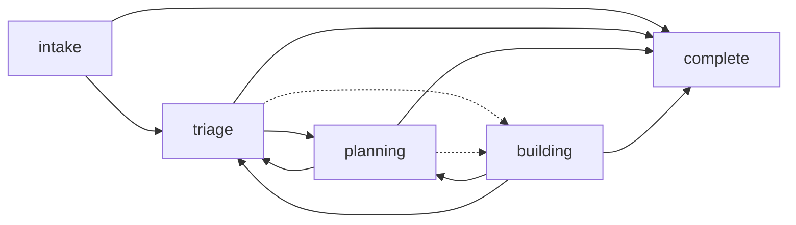
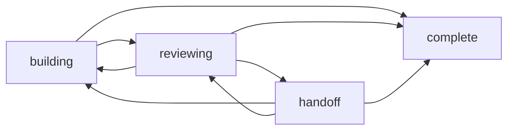
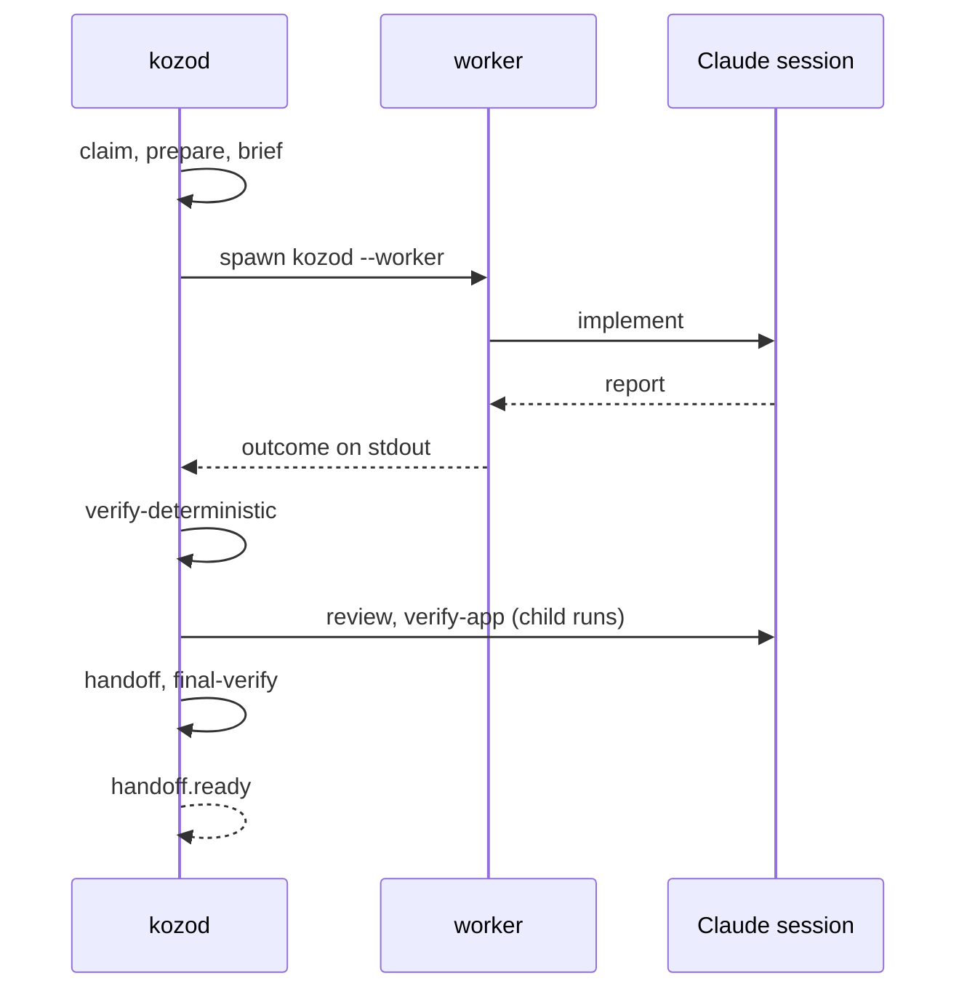

# Lifecycle

How items, tasks and runs move in the code: the stages, the holds, the run states, who moves
each and on what, and one task's run through the blueprint. What each stage and hold means to a
user is on the site's [Concept](../site/src/content/docs/concept.md) page.

Every move is an event (`stage.changed`, `hold.set`, `hold.cleared`, `run.changed`, or
`plan.accepted` for the start of Building), so the state is only ever what the logs replay to.
`applyEvent` in `packages/core/src/state.ts` refuses a move the state does not allow, and
`EventStore` then refuses to write it. kozod appends every stage move and hold through `move`,
`hold` and `clearHold` in `packages/daemon/src/transitions.ts`, which append nothing when the
subject is gone or already as asked. A verb that clears a hold and moves on in the same act,
such as `take`, `return`, `approve`, `reject`, `retry` and `close`, goes through `releaseHold`,
which appends both in one turn of the store's queue and applies them to the state together, so
the scheduler never sees the subject without its hold in between; `by` is `human` when a person's act made the move, a verb
of the local API or a writer's change request or closed Issue on GitHub, and `kozod` otherwise.

`packages/core/src/docs.test.ts` fails when a stage, hold, run state, edge, hold target or
blueprint node on this page differs from the code.

## Stages

The stages are `stageSchema`, the holds `holdKindSchema` and the run states `runStateSchema`, in
`packages/core/src/work-model.ts`.

| Stage | Items | Tasks |
| --- | --- | --- |
| `intake` | A new item, until its start is approved or needs no approval | - |
| `triage` | The triage agent drafts the plan | - |
| `planning` | The plan waits for approval, or the plan agent redrafts it | - |
| `building` | Its tasks run | Created here by `plan.accepted`; claim to verify-deterministic |
| `reviewing` | - | Review and verify-app |
| `handoff` | - | The final verification, then waiting for the merge |
| `complete` | Closed | Closed |
| `cancelled` | Closed | Closed |

An item's own stage stays `building` from its plan's acceptance until it closes or goes back.
What the CLI, the dashboard and the `kozo:<stage>` label show is `itemStage` in
`packages/core/src/state.ts`: the earliest open task's stage, or the item's own stage when it has
no open task. The index keeps it as `items.shown_stage`.

A held subject changes stage only to `cancelled`. Every open stage may go to `cancelled`, which
the diagrams leave out, and nothing leaves `complete` or `cancelled`.

### Item stages

Solid arrows are `itemEdges` in `packages/core/src/state.ts`; the dotted ones are
`plan.accepted`, which starts Building and creates the tasks.

| From → to | Appended by | On | By |
| --- | --- | --- | --- |
| intake → triage | `ControlPlane.admit` in `packages/daemon/src/control-plane.ts` | A new item whose start needs no approval (`startNeeded`) | kozod |
| intake → triage | `ControlPlane.approve` | `approve` on a start approval, or a writer's `kozo:accept` label | human |
| triage → planning | `afterTriage` in `packages/daemon/src/drafting.ts` | A draft whose plan needs approval (`planNeeded`) | kozod |
| triage or planning → building | `plan.accepted` from `afterTriage`, or from `approve` on a plan approval | A plan that needs no approval, or its approval | kozod or human |
| planning → triage | `ControlPlane.retry` | `retry` on an item held in Planning | human |
| building → planning | `Runner.splitAgain` in `packages/daemon/src/runner.ts` | A task blocked on its scope, while the item has no hold; a held item's task tries again once the hold clears | kozod |
| building → triage | `completeTask` in `packages/daemon/src/completion.ts` | The check after the last task's merge failed, or the item failed verify-app as a whole | kozod |
| building → complete | `completeTask` | Every task closed and the check passed | kozod |
| open → complete or cancelled | `ControlPlane.closeWork` | `close`, or the Issue closed on GitHub | human |

### Task stages

Arrows are `taskEdges` in `packages/core/src/state.ts`.

| From → to | Appended by | On | By |
| --- | --- | --- | --- |
| building → reviewing | `verifyDeterministic` in `packages/daemon/src/nodes.ts` | The gates, prove and the diff guard passed | kozod |
| reviewing → building | `BlueprintRun.sendBack` in `packages/daemon/src/task-run.ts` | Review asked for a revision, or verify-app failed, within `inner_retries` | kozod |
| reviewing → handoff | The handoff node | Review and verify-app passed | kozod |
| handoff → building | `BlueprintRun.backToBuilding` | The final rebase conflicted or the deep gates failed, within `ci_fix_rounds` | kozod |
| handoff → building | `GitHubSync.sendBack` in `packages/daemon/src/github-sync.ts` | Red CI on the pushed head within `ci_fix_rounds`, or a writer's change request | kozod or human |
| handoff → building | `ControlPlane.retry` | `retry` on a task whose fix rounds were spent | human |
| any → building | `ControlPlane.giveBack` | `return` of a taken task | human |
| handoff → reviewing | `Reconciler.check` in `packages/daemon/src/reconcile.ts` | Someone else's commits on the task branch after the verified head | kozod |
| handoff → complete | `completeTask` | The check after the merge passed, or failed on the item's last task | kozod |
| open → cancelled | `Runner.splitAgain` | The stopped task and its open dependents, when the item is split again | kozod |
| open → complete or cancelled | `ControlPlane.closeWork` | `close`, or the item closing | human |

`applyEvent` counts as the task moves: every Reviewing → Building adds to `revisions`, which
`afterReview` in `packages/core/src/state.ts` compares with the Charter's `inner_retries`; every Handoff → Building by kozod adds to
`handoffFixes`, which `backToBuilding` and the GitHub sync compare with the Charter's `ci_fix_rounds`. A human
clearing an attention hold in Handoff sets `handoffFixes` back to 0.

## Holds

A subject has at most one hold: `applyEvent` refuses a second, a hold on a closed subject, a kind
its target may not have (`holdTargets` in `packages/core/src/state.ts`) and a clear of another
kind. An approval hold, and only one, says whether it waits for the `start` or the `plan`. A task
whose item or itself is held does not start (`startBlocker`).

| Hold | Targets | Set by | Cleared by |
| --- | --- | --- | --- |
| `approval` | item | `ControlPlane.admit` for a start; `holdForPlanApproval` in `packages/daemon/src/drafting.ts` for a plan | `approve`; `reject` for a plan, which leaves the draft for the plan agent; `close` |
| `question` | item, task | `draftPlan` when triage or plan asks; implement blocked, the diff guard, review escalating and verify-app blocked in `packages/daemon/src/nodes.ts` | `say`, including a reply on GitHub; `retry`; `take`; `close` |
| `attention` | item, task | `BlueprintRun.halt` in `packages/daemon/src/task-run.ts` for a node that cannot go on; no progress after `no_progress_rounds`; spent fix rounds; a defect on a task that is not the item's last; a branch deleted unmerged; a cancelled dependency; a second rejected plan; a run kozod could not start; the GitHub sync | A human only: `retry`, `take` or `close` |
| `dependency` | item, task | `Scheduler.holdForDependencies` in `packages/daemon/src/scheduler.ts`, for a task whose dependencies are open | The same function, once they are complete; a cancelled one turns it into attention. Nothing holds an item for a dependency |
| `capacity` | task | `Scheduler.plan`, when `capacity` names a reason: the Charter not ready, the budget, `max_awaiting_merge` or `max_held` | `Scheduler.plan`, once there is room |
| `paused` | item, task | `pause` | `resume`; `close` |
| `taken` | task | `take`, which replaces an attention or question hold and stops the run | `return`, from a clean worktree on the task branch; `close` |

## Run states

A run is one agent session or one attempt of a task's blueprint. `run.started` starts it as
`running`; it ends once, and its log is then sealed and takes no more events. `RunRecords.endRun`
in `packages/daemon/src/run-records.ts` appends every end but the one at start.

| State | Reached when |
| --- | --- |
| `running` | `run.started` |
| `succeeded` | The blueprint reached its end, a node handed the task on (sent back, held for a question, split again), or a draft returned a plan or a question |
| `failed` | A node halted the run, the fix rounds were spent, a draft was refused, or kozod failed carrying the run on |
| `stopped` | The task was held, closed or paused during a node, or kozod is stopping; the run checkpoints first |
| `lost` | The worker exited without an outcome, or `Reconciler.recover` found the run still open at kozod's start |

A lost or failed run resumes at its checkpoint (`resumePoint` in
`packages/daemon/src/scheduler.ts`).

## One task's run

`Runner` in `packages/daemon/src/runner.ts` runs `nodeSteps` in `packages/daemon/src/nodes.ts`
in the order `blueprintNodes` in `packages/core/src/blueprint.ts` fixes. Each attempt is a run; a
retry starts again at `brief` with the failure in the brief, up to `no_progress_rounds` attempts.
A run starts at `verify-deterministic` for a returned task, at `review` for a task in Reviewing
whose last run succeeded, at the checkpoint of an unfinished run, and otherwise at `claim`.

| Node | Kind | Runs in | Stage | When it does not pass |
| --- | --- | --- | --- | --- |
| `claim` | D | kozod | building | attention |
| `prepare` | D | kozod | building | attention when prepare or a service fails |
| `brief` | D | kozod | building | - |
| `implement` | A | a worker | building | a retry for an invalid report or uncommitted files; split again when blocked on scope; question when blocked otherwise; attention when the session fails, times out or is lost, or refs moved outside the branch |
| `verify-deterministic` | D | kozod | building, then reviewing | a retry when the gates or prove fail; attention when either is misconfigured; question for the diff guard. A diff that changes code raises a low risk tier |
| `review` | A | kozod, as a child run | reviewing | back to Building for a revision within `inner_retries`; question when review escalates; attention otherwise |
| `verify-app` | A | kozod, as a child run | reviewing | as review for a failure; question when blocked. Skipped for the low tier or without an app to verify |
| `handoff` | D | kozod | reviewing, then handoff | - |
| `final-verify` | D | kozod | handoff | `finalVerify` rebases on the default branch and runs the deep gates: back to Building within `ci_fix_rounds` when the rebase conflicts or the deep gates fail; attention after |

Kind D is deterministic and A is an agent, as `node.enter` records it.

## After the merge

`Reconciler.reconcile` in `packages/daemon/src/reconcile.ts` looks every minute at each task in
Handoff whose final verification passed. Once its branch is in the default branch, by ancestry,
patch ID or the pull request's merge commit, it appends `branch.merged` and starts
`completeTask` in `packages/daemon/src/completion.ts`, which runs the gates of the task's risk
tier on the default branch once neither the task nor its item is held. `completeMerged` in
`packages/daemon/src/transitions.ts` then appends the task's completion and the item's move in
one turn of the store's queue, so no hold comes between them:

- **They pass:** the task completes, and the item once all its tasks are closed. On the last
  task of an item that had two or more, `acceptItem` first runs verify-app on the default branch
  against the item's DONE_WHEN, as a run of the item: a pass completes the item, a fail sends it
  back to Triage with a check note and no defect, and a blocked check holds the item for
  attention while the task stays in Handoff.
- **They fail on a task that is not the item's last:** `task.defect` and an attention hold on the
  task, so its dependents wait.
- **They fail on the last task:** the task completes with `task.defect`, and the item goes back to
  Triage, whose new tasks are numbered after the old ones.
- **They are MISCONFIGURED:** no defect; an attention hold on the task until a human fixes the
  constraints, and `retry` runs the check again.

Defects also count toward a class's demotion (`Reconciler.demote`).

## Tests

- `packages/core/src/state.test.ts`: the replay of each move, the illegal transitions, a stage
  under a hold, each hold's targets, a second hold, `itemStage` and the branches.
- `packages/daemon/src/transitions.test.ts`: `move`, `hold` and `clearHold` append once.
- `packages/daemon/src/flow.test.ts`: each path above end to end, with the fake agent.
- `packages/daemon/src/github-sync.test.ts`: the moves GitHub causes.
